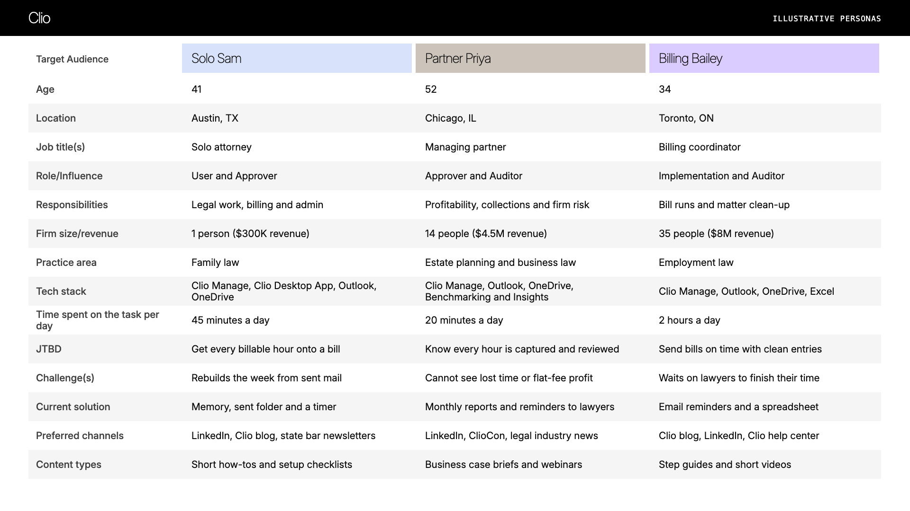
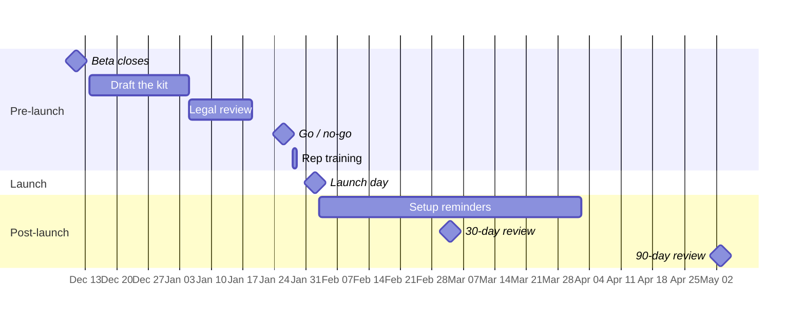
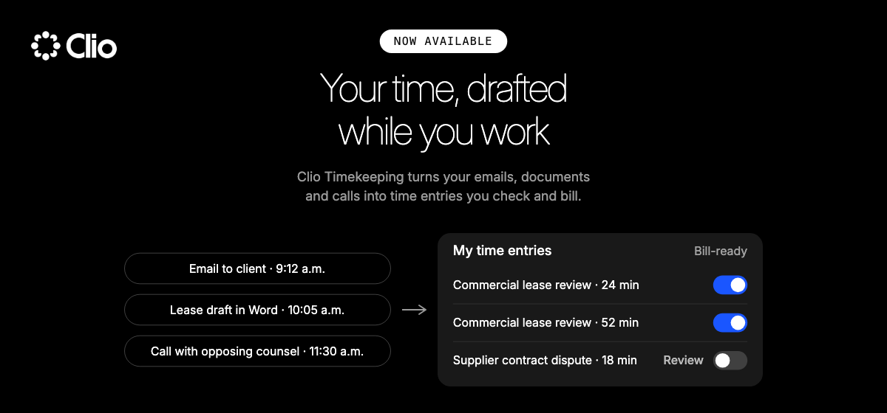
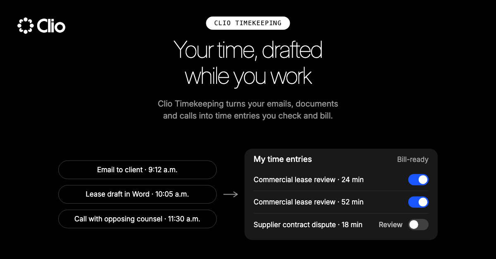
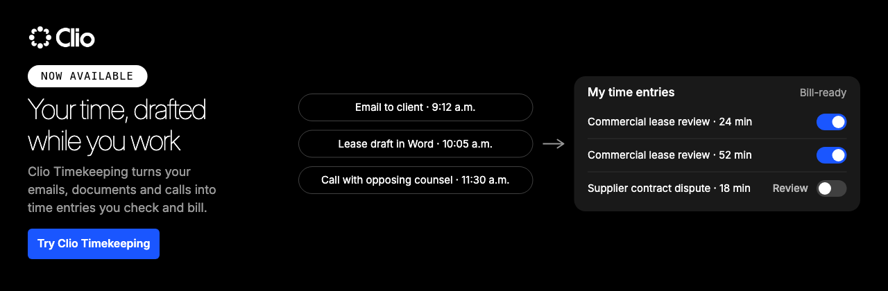

# Clio Timekeeping: GA Launch Plan

**Tier 2** · **Launch day:** Tue Feb 2, 2027 · **Owner:** Product Marketing

Clio Timekeeping drafts a lawyer's time entries as they work. On launch day it becomes available to every Clio Manage customer at no extra cost. **Success: 15% of active firms set up within 60 days.**

Portfolio demo built with Launch CoPilot. Product facts come from Clio's public help article and ClioCon 2026 coverage. Dates, targets and personas are illustrative.

---

## 1. Audience
*Who it's for · Audience agent*

---

## 2. Angle
*Why it wins · Positioning agent*

| | |
|---|---|
| **Alternatives** | Writing time by hand, running a timer, or rebuilding the week from the sent folder |
| **What's different** | Captures billable activity and drafts entries inside Clio Manage, where matters and bills already live |
| **Value** | Lawyers check a list instead of rebuilding the week, and worked time reaches a bill |
| **Best fit** | Solo and small-firm lawyers who record their own time |
| **Category** | Time capture built into legal practice management |
| **Why now** | Clio is unifying Manage, Grow and Work with AI built in, and hybrid billing is growing |

*The message · Messaging agent*

### Stop rebuilding your week.
Clio Timekeeping drafts your time entries as you work. You check them and mark them Bill-ready.

| Pillar | Message | Proof |
|---|---|---|
| **Drafted while you work** | Friday afternoon is for checking a list, not remembering the week | Clio help article |
| **You approve every entry** | Nothing reaches a bill until you switch on Bill-ready | Clio help article |
| **Right where you bill** | Entries land on your matters in Clio Manage, and flat-fee time shows profitability | Help article, LawSites (Oct 2026) |

| Persona | Headline | Call to action |
|---|---|---|
| Solo Sam | Stop rebuilding your week on Friday afternoon | Turn on Clio Timekeeping |
| Partner Priya | Know whether your flat-fee work paid off | Try it on one flat-fee matter |
| Billing Bailey | Fewer bills waiting on missing time | Share the setup checklist with your lawyers |

---

## 3. Aim
*How big a launch · Tiering agent (4Cs)*

| Criterion | Score | Why |
|---|---|---|
| Commercial | 3 / 5 | Included at no extra cost, so it drives engagement rather than new revenue |
| Customer | 5 / 5 | Every Clio Manage customer gets it, and it solves a core pain |
| Competitive | 2 / 5 | The alternatives are manual habits; no competitor gap is proven |
| Category | 4 / 5 | A ClioCon 2026 headline that fits Clio's legal AI story |
| **Result** | **3.5 → Tier 2** | A targeted launch: email, in-app, release note, LinkedIn, sales kit |

*Campaign strategy · Campaign strategy agent*

**The strategy in one line:** reach every Clio Manage customer where they already work (inside Clio and their inbox), turn on the habit in the first 60 days, and arm Sales for the managing-partner conversation.

**What the Tier 2 playbook gives this launch**

| In scope | Deliberately out |
|---|---|
| Customer email with header · In-app message and banner · Release note · LinkedIn post and image · Sales one-pager, talk track, FAQ · 30-min rep session and readiness quiz · Launch checklist | Blog post and hero image · Press release · Paid media · Webinar or event (Tier 1 only) |

**Who we reach, with what**

| Audience | Message | Where | Ask |
|---|---|---|---|
| **Solo Sam** (primary) | Stop rebuilding your week | In-app banner in Clio Manage, launch email | Turn on Clio Timekeeping |
| **Partner Priya** | Know whether your flat-fee work paid off | Sales conversations, LinkedIn | Try it on one flat-fee matter |
| **Billing Bailey** | Fewer bills waiting on missing time | Release note, setup checklist | Share the checklist with your lawyers |

**Channel plan**

| Channel | Pre-launch (Dec 11 to Feb 1) | Launch day (Feb 2) | Post-launch (to May 3) | Measured by |
|---|---|---|---|---|
| **In-app** | Banner built and placed on Activities | Message and banner go live | Reminders to firms not yet set up | Banner click to setup |
| **Email** | Copy reviewed with Legal | Launch email, 9 a.m. local | Day 14 nudge to non-starters | Click to setup |
| **Release note and LinkedIn** | Drafted | Published | Customer proof post at day 60 | Engagement |
| **Sales** | Kit ready, rep session Jan 28, quiz Jan 29 | One-pager and talk track live | Rep questions feed the FAQ | Reps using the battlecard |
| **Customer success** | Setup FAQ ready | Setup help in onboarding calls | Week 3 and week 6 check-ins | Firms still active in week 8 |

---

## 4. Activation
*From plan to launch day, in the order it happens*

*Launch timeline · Launch ops agent*

Everything below runs on this timeline.

*Sales readiness, before launch · Sales enablement agent*

| | |
|---|---|
| **Who to call** | Solo and small-firm lawyers who rebuild their week on Friday; then managing partners with flat-fee work |
| **Ask** | How does your time get onto a bill today? When do you do it? What happens to the hour you forgot? |
| **"I already use a timer."** | Keep it if it works. Timekeeping drafts entries from your activity, and you check each one. |
| **"I don't want software billing for me."** | It doesn't. It drafts. Nothing reaches a bill until you switch on Bill-ready. |
| **"What does it capture?"** | Outlook, OneDrive and computer activity through the Clio Desktop App. I'll follow up with the detail. |

*Launch day assets · Design director agent*

*Launch day email · Copywriter agent*

> **Subject:** Clio Timekeeping is now available
>
> Friday afternoon can mean rebuilding the week from sent mail. Clio Timekeeping drafts your entries as you work, so you just check a list.
>
> It's now available to every Clio Manage customer, on all plans, at no extra cost. Connect Outlook and OneDrive, turn on the Clio Desktop App, and your drafted entries appear under Activities > My time entries. Check each one, then switch on Bill-ready.
>
> **[Try Clio Timekeeping]**

---

## 5. Assessment
*How we'll judge the launch · Campaign strategy agent*

A launch is judged in four layers, read in order. Each layer only matters if the one before it worked.

| Layer | The question | Metric | Target | Read at |
|---|---|---|---|---|
| **1. Readiness** | Was the field ready on day one? | Reps who passed the readiness quiz | 90% | Jan 29 (go/no-go) |
| **2. Campaign** | Did the launch reach and move people? | Launch email: firms that clicked through to setup | 6% of recipients | Day 14 |
| | | In-app banner: click-through to setup | 4% of viewers | Day 14 |
| | | Sales: active deals where reps used the battlecard | 50% | Day 30 |
| **3. Adoption** | Did firms turn it on and keep using it? | Active firms that complete setup | 15% | Day 60 |
| | | Firms still reviewing entries in week 8 | 80% of firms set up | Day 60 |
| **4. Business impact** | Did it change outcomes for customers and for Clio? | Billable time recorded per active user | +10% | Day 90 |
| | | 12-month retention, firms using Timekeeping vs firms that don't | 3 points higher | Two quarters |

**If a layer misses, we fix that layer first.** Readiness: hold the launch until reps pass. Campaign: change the subject line, banner placement or audience. Adoption: take setup friction to Product and add lifecycle nudges. Impact: revisit the message and the target persona.

**Day-90 retrospective:** what worked, what didn't and what we'd change, fed back into the system's lessons so the next launch starts smarter.

*Quality gate · Reviewer agent:* every asset is checked against Clio's own published voice before release. Full review in [12-review.md](12-review.md).

<b>Decisions needed before launch</b>

- Wording on what the desktop app captures, privacy and "AI": Legal and Product, by Jan 19
- Whether admins can see other users' entries: Customer Success and Product, by Jan 26
- Whether to say "about 15 minutes" in copy: Support and Product, by Jan 19
- Whether beta results or quotes can be used publicly: Product Marketing and Legal, by Jan 26

Drafted by Launch CoPilot: 12 agents, reviewed before release. Full launch kit in this folder.
