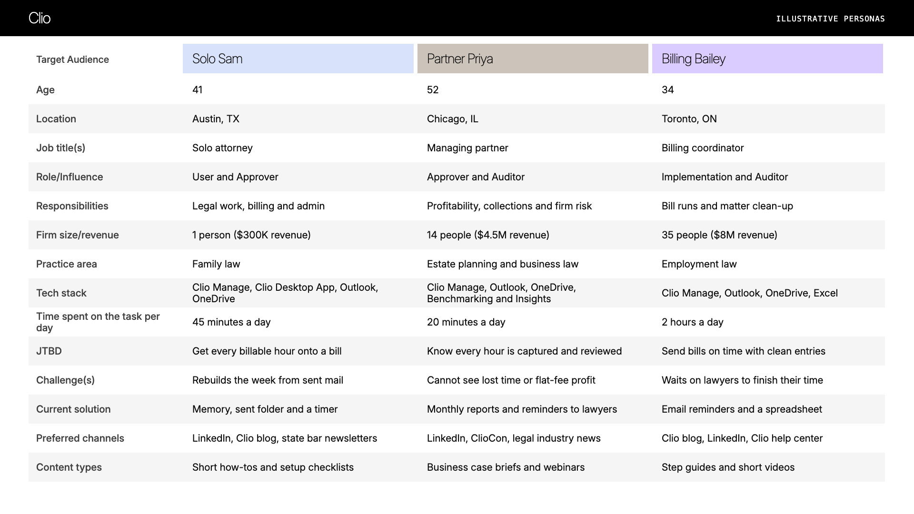

# Audience: Clio Timekeeping general availability

## Illustrative personas
| Target Audience | Solo Sam | Partner Priya | Billing Bailey |
|---|---|---|---|
| Age | 41 | 52 | 34 |
| Location | Austin, TX | Chicago, IL | Toronto, ON |
| Job title(s) | Solo attorney | Managing partner | Billing coordinator |
| Role/Influence | User and Approver | Approver and Auditor | Implementation and Auditor |
| Responsibilities | Legal work, billing and admin | Profitability, collections and firm risk | Bill runs and matter clean-up |
| Firm size/revenue | 1 person ($300K revenue) | 14 people ($4.5M revenue) | 35 people ($8M revenue) |
| Practice area | Family law | Estate planning and business law | Employment law |
| Tech stack | Clio Manage, Clio Desktop App, Outlook, OneDrive | Clio Manage, Outlook, OneDrive, Benchmarking and Insights | Clio Manage, Outlook, OneDrive, Excel |
| Time spent on the task per day | 45 minutes a day | 20 minutes a day | 2 hours a day |
| JTBD | Get every billable hour onto a bill | Know every hour is captured and reviewed | Send bills on time with clean entries |
| Challenge(s) | Rebuilds the week from sent mail | Cannot see lost time or flat-fee profit | Waits on lawyers to finish their time |
| Current solution | Memory, sent folder and a timer | Monthly reports and reminders to lawyers | Email reminders and a spreadsheet |
| Preferred channels | LinkedIn, Clio blog, state bar newsletters | LinkedIn, ClioCon, legal industry news | Clio blog, LinkedIn, Clio help center |
| Content types | Short how-tos and setup checklists | Business case briefs and webinars | Step guides and short videos |

## Who it is for
- **Primary: Solo Sam** (solo or small-firm lawyer, the user). In closed beta, solo lawyers who used to rebuild the week from the sent folder got the most value, which matches `context/personas.md`. Trigger: Friday afternoon, rebuilding the week's time.
- **Secondary: Partner Priya** (managing partner, the approver). In closed beta, a managing partner with flat-fee matters valued seeing captured time, and wants to know what the desktop captures before a firm-wide rollout.
- **Influencer: Billing Bailey** (billing or office admin). Likes entries that arrive bill-ready, but reviews only their own entries, so we make no promise of admin visibility.

**Not for this launch:** firms outside the US and Canada, and large firms with a formal IT rollout process. The GA scope is US and Canada, English.

## Open questions
- What does the Clio Desktop App capture, and how is it handled? Legal and Product. Priya needs this before she says yes.
- Can admins or billers see other users' entries? Customer success and Product. It decides Bailey's role.
- What is Clio's own definition of solo, small and mid-size firm bands? Product marketing. The persona sizes are illustrative until then.
- Can closed beta feedback be used outside Clio? Product marketing and Legal. It stays internal for now.
