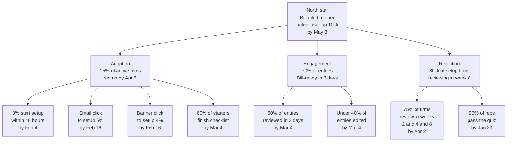

# Campaign strategy: Clio Timekeeping general availability

**Tier 2** (from [03-tiering.md](03-tiering.md)). All dates and targets are illustrative, from the closed beta handoff. Launch day is Tuesday, February 2, 2027 (L-0). The adoption window closes Saturday, April 3 (day 60). Reach is every Clio Manage customer in the US and Canada, in English. Primary audience is Solo Sam ([04-audience.md](04-audience.md)).

## Channel plan
| Phase | Dates | Channel | Tactic and asset | Owner (role) |
|---|---|---|---|---|
| Pre-launch | Dec 11, 2026 to Feb 1, 2027 (L-53 to L-1) | Internal and drafting | Kickoff Dec 14, drafts Jan 5, review Jan 19, staging Jan 26, send check Feb 1. Launch checklist | Launch ops |
| Pre-launch | Kit Jan 5, session Thu Jan 28 (L-5), quiz Fri Jan 29 (L-4) | Sales enablement | 30 minute session and readiness quiz. Sales kit ready | Sales enablement lead |
| Launch | Tue Feb 2 (L-0) | Customer email | Send 9:00 a.m. local time (proposed). Email and header | Lifecycle marketing |
| Launch | Tue Feb 2 (L-0) | In-app | Message and banner with one "Try Clio Timekeeping" button | Product manager, Timekeeping |
| Launch | Tue Feb 2 (L-0) | Release note and LinkedIn | Release note in Clio Manage notes. LinkedIn post and image | Product marketing |
| Launch | Tue Feb 2 (L-0) | Sales | One-pager and talk track in every rep's hands | Sales enablement lead |
| Post-launch | Feb 3 to Apr 2 | In-app | Banner and reminders for firms not done with setup (proposed, to confirm) | Product manager, Timekeeping |
| Post-launch | Feb 3 to May 3 (L+90) | Sales feedback loop | Reps use the kit. Open questions go to the Sales enablement lead | Sales enablement lead |
| Post-launch | Feb 16, Mar 4, Apr 2, May 3 | Measurement | KPI reads from usage data by firm | Revenue operations, Product marketing |

### Phase KPIs
| Phase | KPI | Baseline | Target |
|---|---|---|---|
| Pre-launch | Gates passed, including sales quiz by Jan 29 | 0 of 5 | 5 of 5 |
| Launch day | Active firms starting setup within 48 hours | 0% at GA | 3% by Feb 4 |
| Post-launch | Active firms completing setup | 0% at GA | 15% by Apr 3 |

## KPI tree

| Level | KPI | Target (illustrative) | Time frame |
|---|---|---|---|
| North star | Billable time recorded per active user vs the 30 days before setup | Up 10% | Read at L+90, May 3 |
| Output: Adoption | Active firms completing setup | 15% | Within 60 days, by Apr 3 |
| Output: Engagement | Drafted entries marked Bill-ready within 7 days | 70% | Each review, from Feb 16 |
| Output: Retention | Setup firms with entries reviewed in week 8 | 80% | Week of Mar 29, read Apr 2 |
| Input (Adoption) | Active firms starting setup within 48 hours | 3% | Feb 4 |
| Input (Adoption) | Email click-through to setup | 6% | Feb 16 |
| Input (Adoption) | In-app banner click-through to setup | 4% | Feb 16 |
| Input (Adoption) | Starters who finish the setup checklist | 60% | Mar 4 |
| Input (Engagement) | Drafted entries reviewed within 3 days | 60% | Mar 4 |
| Input (Engagement) | Entries edited before Bill-ready | Under 40% | Mar 4 |
| Input (Retention) | Setup firms with a review in weeks 2, 4 and 8 | 75% | Apr 2 |
| Input (Retention) | Reps trained and passing the quiz | 90% | Jan 29 |

## Measurement plan
| KPI | Baseline | Target | L+30 (Thu Mar 4) | L+60 (Fri Apr 2) | L+90 (Mon May 3) | Owner (role) | It's not working if |
|---|---|---|---|---|---|---|---|
| Billable time per active user | Each user's 30 days before setup | Up 10% | Up 4% | Up 8% | Up 10% | Revenue operations | Under 3% up by Apr 2: retarget the reminders at firms that review weekly and rework the "time you did not lose" message |
| Firms completing setup | 0% at GA | 15% by Apr 3 | 8% | 14% | 16% | Product marketing | Under 4% by Feb 16: change the email subject and the in-app banner placement |
| Entries Bill-ready in 7 days | 0 entries at GA | 70% | 65% | 70% | 72% | Product manager, Timekeeping | Under 55% by Mar 4: add review steps to the checklist and a rep follow-up on the review habit |
| Firms reviewing in week 8 | 0 firms at GA | 80% | 70% | 80% | 82% | Product marketing | Under 65% by Apr 2: send a week 3 and week 6 nudge and run a rep check-in call |
| Starts within 48 hours | 0% at GA | 3% by Feb 4 | 3% | 3% | 3% | Lifecycle marketing | Under 2% by Feb 4: change the email subject and the in-app banner placement |
| Email click-through to setup | 0% at GA | 6% | 6% | 6% | 6% | Lifecycle marketing | Under 4% by Feb 16: rewrite the subject line and move the button above the fold |
| Banner click-through to setup | 0% at GA | 4% | 4% | 4% | 4% | Product manager, Timekeeping | Under 2% by Feb 16: move the banner to the Activities page |
| Setup checklist completed | 0% at GA | 60% of starters | 55% | 60% | 62% | Product manager, Timekeeping | Under 45% by Mar 4: shorten the checklist and add a note on what to connect first |
| Entries reviewed in 3 days | 0% at GA | 60% | 58% | 60% | 62% | Product marketing | Under 45% by Mar 4: rework the review message and add a reminder for unreviewed drafts |
| Entries edited before Bill-ready | 0 entries at GA | Under 40% | 38% | 36% | 35% | Product manager, Timekeeping | Over 50% by Mar 4: brief reps on matter suggestion fixes and update the FAQ |
| Reviews in weeks 2, 4 and 8 | 0 firms at GA | 75% | 70% | 75% | 77% | Revenue operations | Under 60% by Apr 2: target firms that skip a week with an in-app reminder |
| Reps passing the quiz | 0% before session | 90% | 90% | 92% | 92% | Sales enablement lead | Under 80% by Jan 29: rerun the session and hold the launch email to reps |

## Assets in scope (Tier 2)
Customer email, in-app message, release note, LinkedIn post ([08-channel-copy.md](08-channel-copy.md)). Email header, in-app banner, LinkedIn image, one-pager layout ([09-design-briefs.md](09-design-briefs.md), `visuals/`). Sales one-pager, talk track and objections, FAQ ([10-sales-enablement.md](10-sales-enablement.md)). Session plan ([10b](10b-enablement-session.md)). Readiness quiz ([10c](10c-readiness-quiz.md)). Launch checklist ([CSV](11-launch-checklist.csv), [md](11-launch-checklist.md)).

## Go/no-go gates
1. **Mon Dec 14, 2026 (L-50), kickoff:** Product has signed off that the beta is complete. Every asset has a named owner.
2. **Tue Jan 19, 2027 (L-14), kit review:** Every asset has passed review. Legal has returned wording on data capture, privacy and "AI".
3. **Tue Jan 26, 2027 (L-7), go/no-go:** GA build with guided setup is ready. Date, plans and regions confirmed. Revenue operations can count setup by firm. No open flags on customer-facing assets.
4. **Fri Jan 29, 2027 (L-4), rep readiness:** Session ran Jan 28. At least 90% of reps passed the quiz at 80% or better.
5. **Mon Feb 1, 2027 (L-1), final send check:** All channels scheduled and match approved copy. Every button opens setup. Support help content is live.

## Open questions
- Which growth driver does Timekeeping serve: revenue, retention or expansion? Product marketing leadership.
- Does Revenue operations have a per-user billable time baseline, and can the CRM track setup by firm size before Feb 2?
- What does the Clio Desktop App capture, and how is it handled? Legal and Product (gate 2).
- Are the date, plans and regions final? Product manager, Timekeeping (gate 3).
