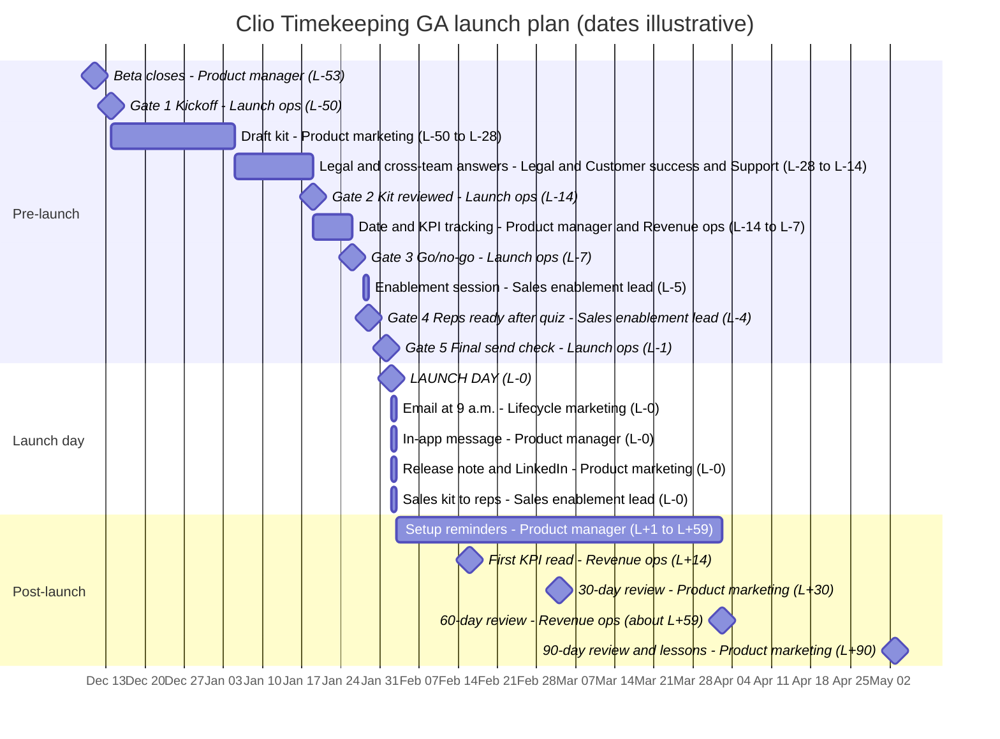

All dates are illustrative, from the closed beta handoff. Launch day is Tue Feb 2, 2027 (L-0). Owners are roles. Import file: [11-launch-checklist.csv](11-launch-checklist.csv).

## Pre-launch
- [ ] Fri Dec 11, 2026 (L-53) | Product manager, Timekeeping | Close beta and sign off
- [ ] Mon Dec 14, 2026 (L-50) | Launch ops | Gate 1: Kickoff, owners named
- [ ] Tue Jan 5, 2027 (L-28) | Product marketing | Draft copy, visuals and sales kit
- [ ] Tue Jan 5, 2027 (L-28) | Product marketing leadership | Confirm growth driver and firm size bands
- [ ] Tue Jan 19, 2027 (L-14) | Legal, with Product and Sales Engineering | Get Legal wording on capture, privacy and AI
- [ ] Tue Jan 19, 2027 (L-14) | Customer success, with Product | Settle admin and biller visibility
- [ ] Tue Jan 19, 2027 (L-14) | Support lead, with Product | Settle the 15 minute wording
- [ ] Tue Jan 19, 2027 (L-14) | Engineering lead | Document matter suggestion behavior
- [ ] Tue Jan 19, 2027 (L-14) | Product marketing, with Legal | Rule on beta numbers and quotes
- [ ] Tue Jan 19, 2027 (L-14) | Brand team | Confirm brand palette and visual object
- [ ] Tue Jan 19, 2027 (L-14) | Revenue operations | Set up KPI tracking by firm
- [ ] Tue Jan 19, 2027 (L-14) | Launch ops | Gate 2: Kit reviewed, Legal wording returned
- [ ] Tue Jan 26, 2027 (L-7) | Product manager, Timekeeping | Confirm date, plans and regions
- [ ] Tue Jan 26, 2027 (L-7) | Launch ops | Gate 3: Go/no-go
- [ ] Thu Jan 28, 2027 (L-5) | Sales enablement lead | Run the 30 minute enablement session
- [ ] Fri Jan 29, 2027 (L-4) | Sales enablement lead | Reps complete the readiness quiz
- [ ] Fri Jan 29, 2027 (L-4) | Sales enablement lead | Gate 4: Reps ready
- [ ] Mon Feb 1, 2027 (L-1) | Support lead | Publish support help content
- [ ] Mon Feb 1, 2027 (L-1) | Launch ops | Gate 5: Final send check

## Launch day
- [ ] Tue Feb 2, 2027 (L-0) | Lifecycle marketing | Send customer email
- [ ] Tue Feb 2, 2027 (L-0) | Product manager, Timekeeping | Publish in-app message and banner
- [ ] Tue Feb 2, 2027 (L-0) | Product marketing | Publish release note and LinkedIn post
- [ ] Tue Feb 2, 2027 (L-0) | Sales enablement lead | Give reps the one-pager and talk track

## Post-launch
- [ ] Wed Feb 3, 2027 (L+1) | Product manager, Timekeeping | Start setup reminders
- [ ] Thu Feb 4, 2027 (L+2) | Revenue operations | Read setup starts at 48 hours
- [ ] Tue Feb 16, 2027 (L+14) | Revenue operations | First KPI read
- [ ] Tue Feb 16, 2027 (L+14) | Sales enablement lead | Review field feedback
- [ ] Thu Mar 4, 2027 (L+30) | Product marketing | 30-day review
- [ ] Thu Mar 4, 2027 (L+30) | Sales enablement lead | Review field feedback again
- [ ] Fri Apr 2, 2027 (about L+59) | Revenue operations | 60-day review
- [ ] Mon May 3, 2027 (L+90) | Product marketing | 90-day review and close out
- [ ] Mon May 3, 2027 (L+90) | Product marketing | Review lessons

## Open questions
- What does the Clio Desktop App capture, and how is it handled? Resolved by "Get Legal wording on capture, privacy and AI".
- Can admins or billers see other users' entries? Resolved by "Settle admin and biller visibility".
- Are the date, plans and regions final? Resolved by "Confirm date, plans and regions".
